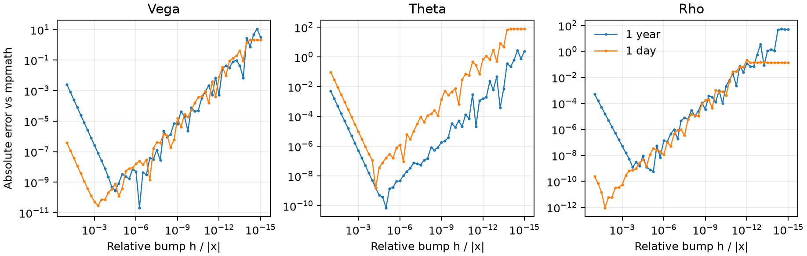

# Vega、Theta、Rho 的数值精度

2026-11-06，Windows x64，Python 3.14.4、NumPy 2.4.6、SciPy 1.18.0、mpmath 1.3.0、QuantLib 1.44。C++ 对照使用 GNU 15.1、Release 构建、关闭 oneTBB。记录覆盖 C++ 的 scalar、serial batch 与 ParUnseq 调用，运行结果不用于推断并行度或吞吐。

## 参考值和样本

用 mpmath 在 80 位十进制工作精度下对价格求导，每次只改变一个输入。输入由同一组 float64 值精确转换。对价内期权，先求价外一侧的权利金导数，再加平价差的导数。这样深度价内时也能保住很小的 Vega。零波动和到期点按 [接口约定](bs_greeks.md#boundaries) 计算单侧导数、极限或中点，QuantLib 对照跳过这 14 个边界期权。

总计 1088 个 Call/Put 场景。其中 768 个常规场景由固定种子生成，280 个压力场景交叉扫描期限、波动率及标准化远期价差，另有 40 个共享黄金样例。黄金样例覆盖负利率、正 Theta、深尾、大额和小额名义金额、零波动和到期。常规样本的期限范围为 0.06 至 12 年，波动率为 8% 至 90%。压力网格最低到 $T=10^{-12}$ 年和 $\sigma=10^{-6}$。

## 误差和通过标准

绝对误差为 $|x-x_\mathrm{ref}|$。常规与压力表列出的尺度化误差以以下量为分母。分母为零时报告绝对误差。

| Greek | 分母 |
| --- | --- |
| Vega | $A\sqrt T$ |
| Theta | $|qA|+|rB|+A\sigma/(2\sqrt T)$，到期时省略扩散项 |
| Rho | $TB$ |

本仓库五条执行路径的全样本尺度化阈值为 $5\times10^{-11}$。对 QuantLib 的常规样本使用同一阈值，压力场景与特殊黄金样例只记录差异。共享黄金样例另检查 $2\times10^{-10}$ 的相对容差，以保留对深尾的约束。接近零时尺度化误差可以很小，即使某个输出的相对误差很大。原始表保留两者，汇总的最大相对误差只计入参考值为正常浮点数的行。

| 实现 | 常规 Vega | 常规 Theta | 常规 Rho | 压力样本最大值 |
| --- | ---: | ---: | ---: | ---: |
| NumPy 原型和向量化 | 6.86e-16 | 9.13e-16 | 1.61e-15 | 2.18e-12 |
| C++ scalar、serial batch、ParUnseq | 6.86e-16 | 6.09e-16 | 1.61e-15 | 2.18e-12 |
| QuantLib 1.44 | 2.56e-16 | 3.32e-15 | 7.13e-16 | 1.00（Rho） |

本仓库的最大压力误差出现在五年、波动率 $10^{-6}$、接近远期平值的 Put Rho。此处极小的标准差放大了计算对数远期价差时的舍入。黄金样例和常规场景均通过阈值。

## 与 QuantLib 对照

用同一个 $F=S e^{(r-q)T}$、$\sigma\sqrt T$ 和 $D=e^{-rT}$ 初始化 `BlackCalculator`，调用 `vega(T)`、`theta(S, T)` 和 `rho(T)`。这里 Theta 按年，Vega、Rho 按输入变化 1.00。源码见 [QuantLib BlackCalculator](https://github.com/lballabio/QuantLib/blob/master/ql/pricingengines/blackcalculator.cpp)。

- 常规 768 个期权的三项比较均达到尺度化阈值。
- 在 `stress_0.25_2_40` 的极深价内 Call，Rho 的高精度参考为 24.8132013705，QuantLib 输出 0。
- 在 `stress_1e-12_1e-06_-2` 的 Put，Theta 的参考为 -0.7446466073，QuantLib 输出 -0.7478177027。这组期限和波动率使远期和行权价之间的有效差值对舍入很敏感。
- 在 `rescaled_call_tail`，高精度 Vega 为 $1.62419\times10^{-150}$。本仓库各路径保留了该值，QuantLib 返回零。黄金样例中还有六个非有限的 QuantLib Theta，CSV 将其标为不可比较。

以上是固定版本、固定输入和接口的实测。结果也依赖先把现货和期限转换成远期、折现和标准差的 float64 舍入。

## 价格中心差分

取 $S=K=100$、$r=0.03$、$q=0.01$、$\sigma=0.2$，剩一年与一天。用现有 Call 定价 API 做中心差分。对 Vega、Theta、Rho 分别扰动 $\sigma,T,r$，Theta 在差分前加负号。每个面板扫描 57 个相对步长，用独立高精度导数作参考。左端主要受截断误差影响，右端主要受价格相减和浮点步长的影响。图上省略误差为零的点，CSV 保留原值。

复现实验见 [运行命令](bs_greeks.md#reproducing-the-checks)。数据为 [高精度参考 CSV](../artifacts/bs-greeks/reference.csv)、[逐项比较 CSV](../artifacts/bs-greeks/comparison.csv)、[误差汇总](../artifacts/bs-greeks/accuracy_summary.csv)、[机器可读结果](../artifacts/bs-greeks/results.json) 和 [步长扫描](../artifacts/bs-greeks/finite_difference.csv)。测试套件另见 [自动测试报告](test_status.md)。
