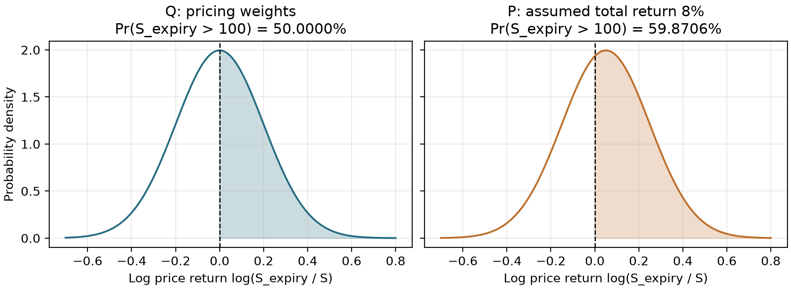
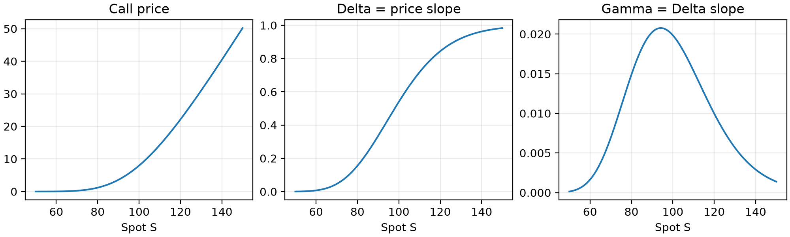

# 01 从扩散模型到 BS 价格与 PDE

目标：先区分预测用的 P 与定价用的 Q，再把扩散模型接到价格函数上，理解后面每个 Greek 究竟对哪个函数求导。用时约 90-120 分钟；1.4 的换测度公式可留到第二轮。先修：正态分布、指数与对数、链式法则，以及 Itô 公式的形式。

## 1. 先固定 P、Q 测度、股息和时间

### 1.1 BS 是模型，Q 是定价时使用的测度

Black-Scholes（含股息时通常称 Black-Scholes-Merton）是一个市场模型。它的欧式期权无套利价格可以写为风险中性测度 $Q$ 下的折现期望。这里 Q 以货币市场账户为计价基准：账户按无风险利率 $r$ 增长。模型与测度是两个不同的对象。

“测度”可以先理解为给事件分配概率的一套规则。相同事件“到期股价超过 100”，在 P 与 Q 下可以有不同的权重；换测度不会把已经发生的股价路径改掉。

| 比较项 | P：物理 / 现实世界测度 | Q：风险中性定价测度 |
| --- | --- | --- |
| 主要问题 | 某个事件将怎样发生、发生概率是多少？ | 可复制收益的无套利价格是多少？ |
| 概率来源 | 对真实数据生成过程建模，用历史数据与当前信息估计 | 在给定市场模型中，由无套利与计价基准确定 |
| 股息再投资后的期望收益率 | 模型中的 $\mu$ | 模型中的 $r$ |
| 股票承担风险的补偿 | 可以有风险溢价 $\mu-r$ | 风险补偿进入事件的定价权重 |
| 概率可否直接当现实预测 | 是预测目标，估计仍可能错 | 不能直接当成 P 下的发生概率 |

在标准单股票、常系数、可连续交易的完备 BS 市场中，给定货币市场账户后，等价风险中性测度唯一。更一般的市场模型可能不完备，不能把这一唯一性无条件推广。

**“风险中性”不等于假设现实中的投资者都不怕风险。**它说的是定价权重下的收益关系。等价测度共享零概率事件，但对非零概率事件可以给出不同概率。基本定义与定价联系可对照 [Utah 讲义，第 2.8、3.5 节](https://www.math.utah.edu/~zhu/5760.13f/chapter06note.pdf)；下文按本课程的连续股息约定独立推导。

### 1.2 一个两状态例子：定价权重从哪里来？

暂设无股息，$r=0$，今天股价 100，一期后只有 120 与 80 两种结果。假设你的现实预测为上涨概率 $p_P=0.7$，于是 $E_P[S_1]=108$。

无套利定价要求在 Q 下股票期望等于今天的 100：

$$
100=120p_Q+80(1-p_Q),\quad p_Q=0.5.
$$

执行价 100 的 Call 两种到期收益为 20 与 0。用半股股票加借入 40 元可以复制这两种收益，因此今天价格是 $0.5\times100-40=10$，也等于 $E_Q[H]=0.5\times20=10$。若直接按 P 的概率且以 $r=0$ 折现，会得到 14，与复制成本不一致。

为什么要用 0.5 定价，不用 0.7？复制组合在两个状态都支付相同的期权收益，价格由复制成本约束。真实上涨概率可以影响你的交易观点，但不能改变这组给定资产价格下的复制成本。

**纸笔停顿 P/Q-1：**将现实上涨概率改成 0.4。重新算 $E_P[S_1]$ 与 Call 的 P 期望收益；Q 权重与复制价格是否改变？

### 停顿 P/Q-1 答案

$E_P[S_1]=96$，$E_P[H]=8$。在今天股价、终值状态及利率不变时，$p_Q=0.5$ 与 Call 复制价格 10 都不变。这里的 0.7、0.4 是教学假设，没有来自市场数据。

### 1.3 同一个扩散模型：P 与 Q 的漂移不同

$u$ 是沿路径前进的日历时间，当前时刻为 $t$，到期为 $t_e$，剩余期限 $T=t_e-t$。固定常数 $r,q,\sigma,\mu$，且 $\sigma>0$。本篇把 $\mu$ 定义为 P 下股票含连续股息的瞬时预期总收益率；除息股价的漂移是 $\mu-q$。有些教材用 $\mu$ 指除息股价漂移，阅读时要先核对约定。

$$
P:\quad dS_u=(\mu-q)S_u\,du+\sigma S_u\,dW_u^P.
$$

$$
Q:\quad dS_u=(r-q)S_u\,du+\sigma S_u\,dW_u^Q.
$$

换测度改变漂移；这个常波动率模型的 $\sigma$ 不变。$W^P$ 在 P 下是布朗运动，$W^Q$ 在 Q 下是布朗运动；不能把二者当作相同测度下的同一个标准正态变量，再逐路径把 $\mu$ 机械替换成 $r$。

**有股息时要小心“折现股票是鞅”这句话。**如果只折现除息股价，则

$$
d(e^{-r(u-t)}S_u)=-q e^{-r(u-t)}S_u\,du+\sigma e^{-r(u-t)}S_u\,dW_u^Q.
$$

当 $q\ne0$ 时它仍有漂移。把股息持续再投资，持股数量按 $e^{q(u-t)}$ 增长；相应折现财富为 $e^{-(r-q)(u-t)}S_u$，在当前常系数模型的 Q 下是鞅。这里“鞅”表示给定当前信息，未来折现财富的条件期望等于当前值。这样才包含了股票的全部收益。

### 1.4 可选深入：换测度是给路径重新加权

先把当前时刻作为未来增量的起点，令 $B_v^P=W_{t+v}^P-W_t^P$，其中 $0\le v\le T$。定义每单位波动风险的收益补偿

$$
\lambda=\frac{\mu-r}{\sigma},\quad L_T=\exp(-\lambda B_T^P-\lambda^2T/2).
$$

$L_T$ 是从当前信息出发的 P 到 Q 的正权重；它满足 $E_P[L_T\mid\mathcal{F}_t]=1$。$\mathcal{F}_t$ 表示今天已经知道的信息。对到期事件 $E$，$1_E$ 是发生时取 1、否则取 0 的指标：

$$
Q(E\mid\mathcal{F}_t)=E_P[L_T1_E\mid\mathcal{F}_t].
$$

当前常数参数下，$B_T^P/\sqrt{T}=z$ 在 P 下服从标准正态。把路径权重乘进密度，配平方可直接看出漂移怎样改变：

$$
e^{-\lambda\sqrt{T}z-\lambda^2T/2}\phi(z)=\phi(z+\lambda\sqrt{T}).
$$

所以 Q 下 $B_T^P$ 的均值变为 $-\lambda T$。Girsanov 定理进一步保证整个过程 $B_v^Q=B_v^P+\lambda v$ 在 Q 下是布朗运动。代回 $dW_u^P=dW_u^Q-\lambda\,du$，得到

$$
(\mu-q)S_u\,du+\sigma S_u(dW_u^Q-\lambda\,du)=(r-q)S_u\,du+\sigma S_u\,dW_u^Q.
$$

这解释了 $\mu$ 为什么变为 $r$。漂移的代数替换必须与概率权重的改变一起发生。这里使用的是有限期限、常数 $\lambda$ 的情形；一般随机风险溢价还需要指数过程满足相应的可积性条件。

到期收益为 $H$ 时，同一个价格也能写在 P 下：

$$
V_t=e^{-rT}E_Q[H\mid\mathcal{F}_t]=E_P[e^{-rT}L_TH\mid\mathcal{F}_t].
$$

$e^{-rT}L_T$ 是当前区间的随机贴现因子。直接用 $e^{-rT}E_P[H]$ 会漏掉风险调整；也不能简单把 BS 价格公式中的 $r$ 换成 $\mu$。常系数 Girsanov 的基础说明见上述讲义；本节的权重归一化和终值密度变化可以只靠高斯配平方验证。

**纸笔停顿 P/Q-2：**用 $E[e^{aZ}]=e^{a^2/2}$ 验证 $E_P[L_T\mid\mathcal{F}_t]=1$。当 $\mu>r$ 时，较大的 $B_T^P$ 在 Q 下是获得更大还是更小的权重？

### 停顿 P/Q-2 答案

$B_T^P=\sqrt{T}Z$，指数矩贡献 $e^{\lambda^2T/2}$，抵消权重中的 $e^{-\lambda^2T/2}$。当 $\mu>r$ 时，$\lambda>0$，较大的布朗增量获得较小权重，使除息价格的期望增长从 $\mu-q$ 降至 $r-q$。

### 1.5 在 Q 下积分，得到定价所需终值分布

下文定价积分均采用 Q；条件于当前 $S_t=S$，为简洁省略 $\mid\mathcal{F}_t$。令 $X_u=\log S_u$；Itô 公式的一阶项是 $dS_u/S_u$，二阶修正是 $-(dS_u)^2/(2S_u^2)$。因此

$$
dX_u=(r-q-\sigma^2/2)\,du+\sigma\,dW_u^Q.
$$

积分从 $t$ 到 $t_e$，布朗增量分布为 $\sqrt{T}Z$，其中 $Z\sim N(0,1)$：

$$
S_{t_e}=S\exp((r-q-\sigma^2/2)T+\sigma\sqrt{T}Z).
$$

**纸笔停顿 A：**写出 $E_Q[S_{t_e}]$。提示：把 $e^{\tau Z}$ 与正态密度相乘，再配平方；$\tau=\sigma\sqrt{T}$。

### 停顿 A 答案

$$
e^{\tau z}\phi(z)=e^{\tau^2/2}\phi(z-\tau),\quad E[e^{\tau Z}]=e^{\tau^2/2}.
$$

因此 $E_Q[S_{t_e}]=Se^{(r-q)T}=F$。终值中的 $-\sigma^2T/2$ 正好抵消正态指数矩带来的 $+\sigma^2T/2$。注意 $F$ 是到期交割的远期价格，不是今天支付的期权价格。

## 2. 先拆收益，再做积分

Call 到期收益为 $(S_{t_e}-K)^+$。风险中性定价把它折现：

$$
C=e^{-rT}E_Q[(S_{t_e}-K)^+].
$$

执行条件 $S_{t_e}>K$ 等价于 $Z>-d_2$，其中

$$
d_2=\frac{\log(S/K)+(r-q-\sigma^2/2)T}{\sigma\sqrt{T}},\quad d_1=d_2+\tau.
$$

把正部拆为“资产收益减现金收益”，分别积分：

$$
C=e^{-rT}(E_Q[S_{t_e}\,1_{Z>-d_2}]-K\Pr_Q(Z>-d_2)).
$$

第二项概率为 $\Phi(d_2)$。第一项使用停顿 A 的配平方：

$$
E_Q[S_{t_e}\,1_{Z>-d_2}]=F\int_{-d_2}^{\infty}\phi(z-\tau)\,dz.
$$

令 $y=z-\tau$，下限变为 $-d_2-\tau=-d_1$，所以第一项为 $F\Phi(d_1)$。最后得到

$$
C=e^{-rT}(F\Phi(d_1)-K\Phi(d_2))=A\Phi(d_1)-B\Phi(d_2).
$$

其中 $A=Se^{-qT}$、$B=Ke^{-rT}$。$\Phi(d_2)$ 是这个模型下的风险中性执行概率；$\Phi(d_1)$ 来自资产加权积分，不能直接也叫同一个概率。

### 2.1 同一事件：Q 概率、P 概率与 Delta

明确事件 $E=\{S_{t_e}>K\}$。欧式 Call 在到期时价内，才有正的内在价值。令上文的 $d_2=d_2^Q$。在 P 下重复对数终值推导得到

$$
d_2^P=\frac{\log(S/K)+(\mu-q-\sigma^2/2)T}{\sigma\sqrt{T}}=d_2^Q+\frac{(\mu-r)\sqrt{T}}{\sigma}.
$$

$$
Q(E)=\Phi(d_2^Q),\quad P(E)=\Phi(d_2^P).
$$

只在当前常系数 GBM 设定下可以这样计算；不额外给出 $\mu$ 等 P 模型信息，就不能从 Q 的概率直接读出 P 概率。二者可能相等，但无需相等，也没有一般意义上“Q 总是比 P 大”的结论。

用课程的非零利率/股息 ATM 参数：$S=K=100,r=0.03,q=0.01,\sigma=0.20,T=1$。额外假设 P 下含股息预期总收益 $\mu=0.08$；这 8% 是教学假设，没有经过历史估计。于是 $d_2^Q=0$、$d_2^P=0.25$、$d_1^Q=0.20$。

| 量 | 数值 | 应怎样读 |
| --- | --- | --- |
| $Q(S_{t_e}>100)=\Phi(d_2^Q)$ | 50.0000% | 定价测度下到期价内概率 |
| $P(S_{t_e}>100)=\Phi(d_2^P)$ | 59.8706% | 假设 $\mu=8\%$ 时模型预测的到期价内概率 |
| $\Phi(d_1^Q)$ | 57.9260% | 资产加权积分的因子；不是上述 Q 到期事件概率 |
| Call $\Delta=e^{-qT}\Phi(d_1^Q)$ | 0.573496 | 每单位 S 变动的局部价格敏感度 / 复制持股量 |

图的横轴为一年对数价格收益 $\log(S_{t_e}/S)$，不含已收股息。两种密度标准差均为 0.2；Q 均值为 0，P 均值为 0.05。右侧阴影标出同一事件 $S_{t_e}>100$；完整右尾的概率分别为 0.5 与 0.598706，图中只显示有限横轴范围，标题数值按 CDF 计算。图是上述模型参数的演示，不是行情拟合。

第 02 篇会推出 Delta 公式。Delta 是导数，即使某些情况下数值落在 0 与 1 之间，也不能因此直接当成 P 下的发生概率。连续、非退化 BS 分布下，Put 的到期价内概率对应 $\Phi(-d_2^Q)$ 与 $\Phi(-d_2^P)$。

“到期价内”“买入期权扣除权利金后盈利”“到期前曾触及执行价”是三个不同事件。例如以现金借款支付 Call 权利金、忽略费用且持有至到期，盈利条件是 $S_{t_e}>K+Ce^{rT}$；不能继续用 $S_{t_e}>K$ 的概率来回答。到期前触及概率还需要路径信息。

**纸笔停顿 P/Q-3：**令 $\mu=r$，上述两种到期价内概率会怎样？再假设总收益率降为 1%，其余参数不变，算出 $d_2^P$ 与 P 概率。最后只改变 $\mu$，BS Call 价格会变吗？

### 停顿 P/Q-3 答案

$\mu=r$ 时 $d_2^P=d_2^Q$；这不是一般市场必有的事实。$\mu=0.01$ 时 $d_2^P=-0.10$，P 概率约 46.0172%，低于这里固定的 Q 概率 50%。固定 $S,K,r,q,\sigma,T$ 时，Call 价格仍约 8.827321；改变 P 下的 $\mu$ 不改变 BS 复制价格。

**纸笔停顿 B：**从 $d_2$ 写出远期形式 $d_1=m/\tau+\tau/2$，其中 $m=\log(F/K)$。再验证 $d_1-d_2=\tau$。

### 停顿 B 答案

$m=\log(S/K)+(r-q)T$，因此 $d_2=m/\tau-\tau/2$，$d_1=m/\tau+\tau/2$。把 $r-q$ 收入远期 $F$，能让多处公式共享同一组中间量。

## 3. 同一模型怎样给出 PDE？

现在直接在 P 下推导，看看预期收益率 $\mu$ 怎样消失。对平滑价格 $V(S,u)$ 用 Itô 公式。记 $V_u$ 为日历时间偏导：

$$
dV=(V_u+(\mu-q)SV_S+\sigma^2S^2V_{SS}/2)\,du+\sigma SV_S\,dW_u^P.
$$

股票含股息的收益增量是 $dS+qS\,du=\mu S\,du+\sigma S\,dW_u^P$。用 $\Delta=V_S$ 股标的对冲随机项；以当前 Delta 建立并自融资调仓的组合，在一个瞬间的增量是 $dV-\Delta(dS+qS\,du)$。其中 $\mu SV_S$ 与随机项同时抵消，只留下 $-qSV_S$。组合价值是 $V-\Delta S$，无风险收益应为 $r(V-\Delta S)du$。因此

$$
V_u+\sigma^2S^2V_{SS}/2-qSV_S=r(V-SV_S).
$$

移项得到 BS PDE：

$$
V_u+\frac12\sigma^2S^2V_{SS}+(r-q)SV_S-rV=0.
$$

若改用剩余期限 $T$，则 $V_u=-V_T$。这解释了 Theta 的符号约定：

$$
\Theta+\frac12\sigma^2S^2\Gamma+(r-q)S\Delta-rV=0,\quad \Theta=-V_T.
$$

对冲增量不是直接把 $d(V-\Delta S)$ 当成无需融资的组合微分；Delta 随状态变化，调仓现金流由自融资条件处理。这也是为什么推导中必须说清交易规则。

这条 PDE 没有 $\mu$，给出了风险中性定价背后的复制理由。在相同市场参数与交易假设下，不同的 P 预测可以对应同一个无套利价格；价格相同不说明预测概率相同。

## 4. 把 PDE 连到你熟悉的扩散方程

令 $x=\log S$、$v(x,T)=V(e^x,T)$。链式法则给出 $SV_S=v_x$ 和 $S^2V_{SS}=v_{xx}-v_x$。于是

$$
v_T=\frac12\sigma^2v_{xx}+(r-q-\sigma^2/2)v_x-rv.
$$

设 $a=r-q-\sigma^2/2$，作平移与折现变换

$$
v(x,T)=e^{-rT}w(x+aT,T).
$$

分别求左右导数，$aw_y$ 与 $-rw$ 抵消，留下 $w_T=\sigma^2w_{yy}/2$。初值为 $w(y,0)=(e^y-K)^+$。热核卷积就是

$$
w(y,T)=\int_{-\infty}^{\infty}(e^{y+\tau z}-K)^+\phi(z)\,dz.
$$

这与第 2 节的风险中性积分相同。高斯核平滑了到期折点；Delta 是平滑后价格的斜率，Gamma 是曲率，正是数值求导要恢复的对象。

**纸笔停顿 C：**自己计算 $v_T,v_x,v_{xx}$，验证上述平移的符号。再写出 Call 的到期条件和两个空间边界。

### 停顿 C 答案

$v_T=e^{-rT}(w_T+aw_y-rw)$，$v_x=e^{-rT}w_y$，$v_{xx}=e^{-rT}w_{yy}$。Call：$C(S,0)=(S-K)^+$；$S\to0$ 时价格趋于 0，$S\to\infty$ 时趋于 $A-B$。数值 PDE 中用有限的 $S_{\max}$ 近似后一边界，会引入截断边界误差。

## 5. 第一张手算卡

原作业场景 1：$S=K=100,r=q=0,\sigma=0.2,T=1$。因此 $F=100$、$\tau=0.2$、$d_1=0.1,d_2=-0.1$。

$$
C=100(\Phi(0.1)-\Phi(-0.1))\approx7.96556746.
$$

请在纸上解释为什么这个价钱不是 $E_Q[S_{t_e}]-K=0$：正部运算在期望之内，亏损的路径被截掉。

图采用场景 1 的参数，只改变 $S$。价格曲线的切线斜率对应 Delta，Delta 曲线的斜率对应 Gamma。下一篇把这句话逐行化为公式。

## 6. 接到代码与下一篇

现有 `Python_prototype/black_scholes.py::bs_price_call` 与 C++ `bs_price_call` 实现的是上述闭式价格；不是 PDE 网格求解器。PDE 求解、风险中性积分、闭式公式是三种计算同一模型价格的路线，它们各有自己的数值误差。

### 6.1 接到 Jerry 的行情与美股研究平台

- 期权报价、利率、股息与合约信息 → 校准模型 / IV → 研究 Q 下的定价与隐含风险权重。BS 的 $\Phi(d_2)$ 是单一常波动率模型的概率；不能把不同执行价各自的 IV 直接拼成一个保证一致的概率分布。
- 历史收益、因子、宏观与事件样本 → 构造 P 下预测 → 用样本外频率、概率校准与适当评分检验。P 的概率是现实研究的目标，历史估计仍带有抽样和模型误差。
- 比较二者时固定事件定义、期限、信息时点及模型口径。期权隐含风险变化可以成为预测特征，但含有风险补偿的定价权重，不能单独解释为事件实际发生率的变化。

例如输出列可以明确叫 `q_prob_terminal_itm_bs` 与 `p_prob_terminal_itm_model`，同时保存参数、观测时点和模型版本；`delta` 保留其导数含义。这是研究平台的数据命名建议，现有生产 API 本次没有新增概率接口。

联储研究人员关于期权隐含崩盘概率的 [2014 年 FEDS Note](https://www.federalreserve.gov/econresdata/notes/feds-notes/2014/forecasting-stock-market-crashes-is-hard-especially-future-ones-20140507.html) 解释了风险厌恶如何影响保险期权价格，以及隐含概率可作为预测信息而非直接的现实发生率。这是其特定研究样本的讨论，不是所有资产、所有事件都满足同一方向的概率偏差。

复习：遮住正文，重建 P/Q 权重 → Q 终值分布 → 执行阈值 → 配平方 → 两个 CDF → P 下对冲消去 $\mu$ → PDE 的完整链。进一步参考体系见 [Oxford 课程纲要](https://courses.maths.ox.ac.uk/course/info.php?id=6476)。
