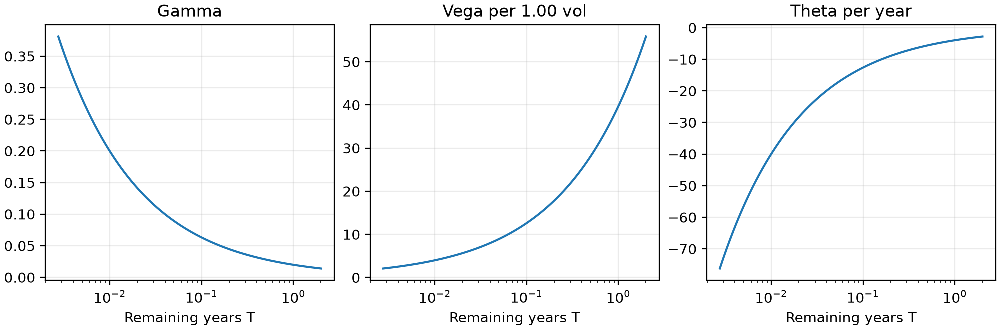
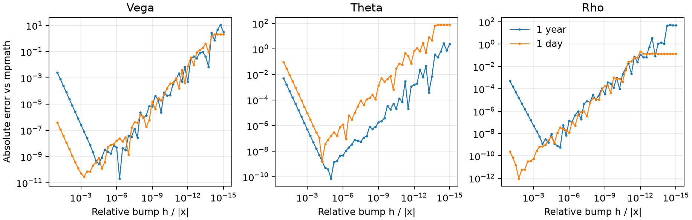

# 06 Vega、Theta、Rho 的纸笔推导

先从风险中性股价的 Itô 方程推到价格公式，再对价格求三个偏导。第 02 篇讲 Delta、Gamma 和密度恒等式。第 03 至 05 篇可配合数值部分阅读。

## 0. 从 Itô 方程到价格公式

### 股价的 SDE 和期权的 PDE

记当前日历时刻为 $t$，到期时刻为 $t_e$，剩余期限为 $T=t_e-t>0$。用 $u$ 表示中间时刻，$S=S_t$。在以货币市场账户为计价基准的风险中性测度 $Q$ 下，股票的总收益漂移是 $r$。股东连续收到股息 $qS_u\,du$，因此除息股价满足

$$
dS_u=(r-q)S_u\,du+\sigma S_u\,dW_u^Q.
$$

期权价值是 $V(u,S_u)$。对它用 Itô 公式，得到

$$
dV=\left(V_u+(r-q)S_u V_S+\frac{1}{2}\sigma^2 S_u^2V_{SS}\right)du
+\sigma S_u V_S\,dW_u^Q .
$$

欧式期权在到期前没有现金流。对 $e^{-r(u-t)}V(u,S_u)$ 再用乘积法则，贴现产生的漂移为 $-rV$ 乘以贴现因子。风险中性定价要求贴现价值为鞅，所以括号里的漂移减去 $rV$ 后应为零。由此得到 Black-Scholes PDE 和 Call 的终值条件：

$$
V_u+(r-q)sV_S+\frac{1}{2}\sigma^2s^2V_{SS}-rV=0,\qquad
V(t_e,s)=\max(s-K,0).
$$

这里 $s$ 表示 PDE 的股价坐标。SDE 描述股价路径，PDE 描述价值函数在时间和股价上的变化。对贴现价值用鞅的条件期望性质，就把终值条件带回了当前价格：

$$
C(t,S)=e^{-rT}\,\mathbb{E}^{Q}\left[\max(S_{t_e}-K,0)\mid S_t=S\right].
$$

### 对数股价给出 $m$ 和 $\tau$

对 $\log S_u$ 用 Itô 公式。因为二阶导数为 $-1/S_u^2$，Itô 修正把对数漂移减去 $\sigma^2/2$：

$$
d\log S_u=\left(r-q-\frac{\sigma^2}{2}\right)du+\sigma\,dW_u^Q.
$$

从 $t$ 积分到 $t_e$，令 $Z=(W_{t_e}^Q-W_t^Q)/\sqrt T$，则 $Z$ 在 $Q$ 下服从标准正态分布。写成

$$
S_{t_e}=F e^{-\tau^2/2+\tau Z},\qquad
F=S e^{(r-q)T},\qquad \tau=\sigma\sqrt T .
$$

$F$ 是风险中性期望的到期股价，也是连续股息下的远期价。$\tau$ 是这段期限内对数收益的标准差。把远期相对行权价的距离写成对数，得到 $m=\log(F/K)=\log(S/K)+(r-q)T$。因此

$$
\log(S_{t_e}/K)=m-\frac{\tau^2}{2}+\tau Z .
$$

### 两条支付腿给出 $A,B,d_1,d_2$

当 $\tau>0$，Call 有支付的条件是 $S_{t_e}>K$，也就是 $Z>-d_2$，其中

$$
d_2=\frac{m-\tau^2/2}{\tau},\qquad Q(S_{t_e}>K\mid S_t=S)=\Phi(d_2).
$$

支付分成收到一股股票和付出行权价两项。记 $D=e^{-rT}$。行权价项的系数为 $B=DK=K e^{-rT}$，乘上行权概率得到 $B\Phi(d_2)$。股票项的系数为 $A=DF=S e^{-qT}$，但还要对 $e^{-\tau^2/2+\tau Z}$ 加权。配方后，标准正态密度平移了 $\tau$：

$$
e^{-\tau^2/2+\tau z}\phi(z)
=\frac{1}{\sqrt{2\pi}}e^{-(z-\tau)^2/2}
=\phi(z-\tau).
$$

股票项从 $-d_2$ 积到正无穷。换元 $y=z-\tau$，积分下限变为 $-d_2-\tau$，所以该项是 $A\Phi(d_2+\tau)$。于是

$$
d_1=d_2+\tau=\frac{m+\tau^2/2}{\tau},\qquad
C=A\Phi(d_1)-B\Phi(d_2).
$$

$\Phi(d_2)$ 是上述 $Q$ 下的行权概率，$\Phi(d_1)$ 来自按到期股价加权的积分。用 $F=K$ 检查符号，此时 $A=B$、$m=0$，因此 $d_1=\tau/2$、$d_2=-\tau/2$。

## 1. 先做一张偏导表

以下沿用刚推得的变量，$r,q,\sigma$ 均为常数，期限 $T$ 按年计。对任一输入 $x$，从 $d_1=m/\tau+\tau/2$ 和 $d_2=d_1-\tau$ 应用商法则，得到

$$
(d_1)_x=\frac{m_x}{\tau}+\left(\frac12-\frac{m}{\tau^2}\right)\tau_x,\quad(d_2)_x=(d_1)_x-\tau_x.
$$

| 变量 x | m 的导数 | tau 的导数 | d1 的导数 |
| --- | --- | --- | --- |
| S | $1/S$ | $0$ | $1/(S\tau)$ |
| sigma | $0$ | $\sqrt T$ | $-d_2/\sigma$ |
| r | $T$ | $0$ | $\sqrt T/\sigma$ |
| q | $-T$ | $0$ | $-\sqrt T/\sigma$ |
| T | $r-q$ | $\tau/(2T)$ | $(r-q)/\tau-d_2/(2T)$ |

每次只改变一个输入。即使这一行参数恰好满足 $q=r$，求 Rho 时也只改 $r$，并固定现货 $S$。如果系统以远期 $F$ 为输入，须说明求导时固定的是现货还是远期。

**纸笔停顿 A：**自己推导 $d_{1,\sigma}$ 与 $d_{1,T}$，不要直接背表。

### 停顿 A 答案

$d_{1,\sigma}=\sqrt T(1/2-m/\tau^2)=\sqrt T-d_1/\sigma=-d_2/\sigma$。期限导数为 $(r-q)/\tau+\tau/(4T)-m/(2T\tau)=(r-q)/\tau-d_2/(2T)$。

## 2. Vega

$A/B=e^m$，而 $(d_1^2-d_2^2)/2=m$，所以两条价格腿的密度权重相等。把共同权重记作 $H=A\phi(d_1)=B\phi(d_2)$。对 $\sigma$ 求导时 $A,B$ 不变，于是

$$
\nu=C_\sigma=H((d_1)_\sigma-(d_2)_\sigma)=H\tau_\sigma=A\phi(d_1)\sqrt T.
$$

因为 $S,\sigma,T>0$ 且 $\phi>0$，Vega 为正。可从 Gamma 公式消去同一个密度因子：

$$
\nu=\sigma T S^2\Gamma.
$$

对本模型的欧式 Call 和 Put，都可以用已有的 Gamma 核对 Vega。这条恒等式依赖常参数 Black-Scholes 模型。

**纸笔停顿 B：**场景 1 取 $S=K=100$、$r=q=0$、$\sigma=0.20$、$T=1$。算出 Vega，再估计波动率从 0.20 到 0.21 时的价格变化。

### 停顿 B 答案

$\nu\approx39.69525475$，乘以 $\delta\sigma=0.01$ 得价格的一阶变化，约 0.39695255。场景 2 只把波动率降到 0.01、期限缩到 $1/365$ 年，Vega 约为 2.08815926。对照两个场景的 Gamma 时，记得 Vega 与 Gamma 相差一个 $\sigma T S^2$ 因子。

## 3. Rho 与股息敏感度

对 $r$ 求导，$A_r=0$，$B_r=-TB$，且 $d_{1,r}=d_{2,r}$。CDF 导数项消去，留下

$$
\rho_C=C_r=TB\Phi(d_2).
$$

对 $q$ 求导，$A_q=-TA$，$B_q=0$，同理

$$
\psi_C=C_q=-TA\Phi(d_1)=-TS\Delta_C.
$$

这两个导数取决于“其余变量固定”的约定。现实中期限结构、股息和远期可能一起变动；真实组合冲击需要把输入变化链式传播。

## 4. Theta 与剩余期限

$A_T=-qA$、$B_T=-rB$、$d_{1,T}-d_{2,T}=\tau/(2T)$。所以

$$
C_T=-qA\Phi(d_1)+rB\Phi(d_2)+H\frac{\tau}{2T}.
$$

日历时间向前，剩余期限缩短，故 $\Theta=-C_T$：

$$
\Theta_C=-\frac{A\phi(d_1)\sigma}{2\sqrt T}-rB\Phi(d_2)+qA\Phi(d_1).
$$

第一项来自扩散，后两项分别来自现金和股息。深度价内的 Call 如果股息率够高，股息项可以超过另外两项，使 Theta 为正。

将它和 Delta/Gamma 代回 PDE，应满足

$$
\Theta+\frac12\sigma^2S^2\Gamma+(r-q)S\Delta-rV=0.
$$

**纸笔停顿 C：**把场景 1 的参数与 Gamma 代入 PDE 求 Theta，再和闭式解核对。

### 停顿 C 答案

$\Theta=-\sigma^2S^2\Gamma/2\approx-3.969525475$（每年）。每日线性近似为 $\Theta/365\approx-0.01087541$，不是把原公式直接改成每天到期；有限一天的价格差还包括高阶期限效应。

## 5. 用价格差分复核偏导

将价格视为六个输入的函数 $V(S,K,r,q,\sigma,T)$。对选定输入 $x$，定义中心差分与 CS：

$$
V_x\approx\frac{V(x+h_x)-V(x-h_x)}{2h_x},\quad V_x\approx\frac{\operatorname{Im}V(x+ih_x)}{h_x}.
$$

Vega bump $\sigma$；Rho bump $r$；股息敏感度 bump $q$；Theta 则在 bump $T$ 得到的导数前加负号。每种输入的量纲不同，不能统一用同一个绝对步长。

对 $\sigma$ 或 $T$ 做中心差分时，让 $x-h_x>0$。边界处改用单边公式，收敛阶需要重新推导。复步法需要价格函数在该方向上支持复数 sqrt、log 和 CDF 分派。

普通一阶偏导用完整解析价格时是 $O(h_x^2)$。有限截断 CDF 经新参数的复合链后，应逐方向验证；对 Spot Delta 验证过，不表示 Vega/Theta 自动也验证过。

## 6. 用 Delta、Gamma 和独立价格核对

解析式对照数值偏导，是第一类。PDE 残差 $R_{PDE}$，是第二类。Vega-Gamma 关系残差，是第三类：

$$
R_\nu=\nu-\sigma TS^2\Gamma.
$$

这些残差能定位单位、符号和公式错误，但共享代码错误可能同时让多个残差变小。至少搭配独立高精度价格求导和非零 $r,q$ 场景；零利率零股息会隐藏很多错误。



图取零 carry、ATM、$\sigma=0.2$，展示 Gamma、Vega 和年度 Theta 随期限改变。不要比较纵轴数值大小来判断哪个风险“更大”，因为单位不同。

## 7. Put、零波动和到期

平价给出 $C-P=A-B$。分别对 $\sigma,r$ 和日历时间求导，得到 $\nu_C=\nu_P$、$\rho_C-\rho_P=TB$、$\Theta_C-\Theta_P=qA-rB$。代码用 $\eta=1$ 表示 Call、$\eta=-1$ 表示 Put，统一写成

$$
\rho=\eta TB\Phi(\eta d_2),\qquad
\Theta=-\frac{H\sigma}{2\sqrt T}+\eta\left(qA\Phi(\eta d_1)-rB\Phi(\eta d_2)\right).
$$

$\sigma=0$ 时，价格是 $\max(\eta(A-B),0)$。如果 $A=B$ 且 $T>0$，从 $\sigma>0$ 逼近时 $d_1,d_2\to0$，所以 Vega 的右导数为 $A\sqrt{T/(2\pi)}$。Rho 在这个折点有两个不同的单侧导数，接口取中点 $\eta TB/2$。设 $g=\eta(qA-rB)$。从当前日历时点往前走一小步，带符号的贴现内在价值增加约 $g$ 乘以步长，因此折点的日历右导数是 $\max(g,0)$。

到期时 Vega、Rho 为零，因为支付只取决于 $S,K$。价内 Theta 趋于 $g$，价外趋于零。平值且 $\sigma>0$ 时，$d_1,d_2\to0$，扩散项随 $1/\sqrt T$ 发散，Theta 趋于 $-\infty$。平值且 $\sigma=0$ 时，从 $T>0$ 取极限得到 $\min(g,0)$。接口用到期前的极限作为到期点的 Theta。

## 8. 低波动时怎样保住 Theta

当 $r$ 接近 $q$，且 $d_1$ 接近 $d_2$，两项贴现现金流可能几乎相等。用 $A=B e^m$ 改写，令 $c=m/\tau$，则

$$
\eta(qA\Phi(\eta d_1)-rB\Phi(\eta d_2))
=\eta(q(e^m-1)+q-r)B\Phi(\eta d_2)+qA I,
$$

其中 $I=\Phi(c+\tau/2)-\Phi(c-\tau/2)$。把 $\phi(c+x)$ 对 $x$ 展开后，在 $[-\tau/2,\tau/2]$ 上积分。奇数项相消，$\phi''(c)=(c^2-1)\phi(c)$，得到

$$
I=\tau\phi(c)\left(1+\frac{(c^2-1)\tau^2}{24}+O(\tau^4)\right).
$$

实现用 `expm1(m)` 计算 $e^m-1$，并在 $\tau(1+|c|)\le 10^{-3}$ 时使用上面的积分近似。深尾的密度和概率先与贴现、名义金额合并，再从对数转换回普通数值。这样即使单独算出的概率已经下溢，乘上足够大的金额后仍可能得到可表示的结果。

## 9. 跑一次原型

原型依赖 NumPy 和 SciPy。在仓库根目录运行下列命令。如果朋友只拿到单独的脚本，在脚本所在目录执行 `python greeks_prototype.py`。

```powershell
python Python_prototype/greeks_prototype.py
```

原型里的 `greeks_scalar` 接收 `S, K, r, q, sigma, T`。示例取 $S=K=100$、$r=0.03$、$q=0.01$、$\sigma=0.20$、$T=1$。Call 的 Vega 每波动率百分点约为 0.38715175，Theta 每年约为 -4.75368986，Rho 每利率百分点约为 0.48522277。试着只把利率从 3% 改为 3.01%，然后用价格差核对 Rho 的基点单位。



图上两个情景分别剩一年和一天。步长先减小时，截断误差下降。继续缩小，两个 float64 价格的舍入误差会被 $2h$ 放大。比较不同变量时用相对步长，各面板的绝对误差单位仍各不相同。

## 10. 怎样读精度结果

实验用 80 位十进制工作精度对价格求导，共比较 1088 个 Call 和 Put。NumPy 和 C++ 在常规样本上的最大尺度化误差约为 $1.61\times10^{-15}$，在压力样本上约为 $2.18\times10^{-12}$。尺度化误差以各 Greek 的自然量级为分母。接近零的 Greek 还应查看相对误差和原始值。

QuantLib 1.44 在常规样本中也达到相同的通过阈值。一个极深价内 Call 的 Rho 则返回 0，高精度参考约为 24.81。试用 `reference.csv` 找到 `stress_0.25_2_40`，代入 $TB\Phi(d_2)$，看这时 $\Phi(d_2)$ 接近多少。

向量化接口见 [Vega、Theta、Rho API](../bs_greeks.md)。样本定义、阈值和原始 CSV 见 [数值精度报告](../bs_greeks_accuracy.md)。下一篇从支付函数推出 Put 与 Call 的平价。
